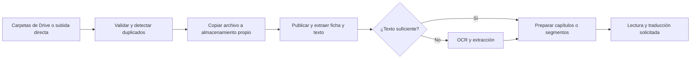

# Plan de desarrollo y especificación técnica

**Proyecto:** biblioteca comunitaria de fanfics  
**Estado:** especificación en elaboración a partir de las respuestas del propietario  
**Última actualización:** 31 de octubre de 2026

## 1. Objetivo y alcance de la primera versión

Construir una biblioteca gratuita para cualquier persona interesada en fanfics. Toda la aplicación, incluido el catálogo y la lectura, requiere una cuenta con el correo verificado y una declaración de mayoría de edad (18 años), sin verificación de identidad. Se conservarán el diseño y el sistema de acceso existentes como punto de partida.

La primera versión debe incluir **todas** las funcionalidades solicitadas: importación completa de la colección, organización y eliminación de duplicados, aportaciones, roles, fichas y filtros, lectura, traducción completa, favoritos y colecciones privadas, OCR cuando se necesite, tracker de AO3 y recordatorios por correo. Las fases de este documento ordenan la implementación y las pruebas; no reducen el alcance de esa primera versión.

El contenido permitido es fanfics de AO3 y, como excepción, PDF de fanfics personales. Los formatos admitidos son PDF y EPUB. Otros tipos de contenido no forman parte del catálogo.

No es necesario decidir un nombre ni un dominio ahora. El piloto será con tres personas. El propietario autoriza evaluar cambios de tecnología si son convenientes y prefiere proveedores con pago por uso. Todavía no ha fijado un límite de gasto.

## 2. Estado inicial

La aplicación parte de React/TypeScript con Cloudflare D1 y R2, Better Auth, verificación de correo y recuperación de contraseña. Se ha añadido un catálogo compartido, conservando las tablas y archivos de la biblioteca privada anterior.

La implementación permanece local y no se ha publicado. Las pruebas con servicios externos reales e importación de la colección están pendientes de disponer de cuentas, configuración y enlaces. Hay cambios locales sin confirmar que deben preservarse. El PDF de ejemplo tiene texto y metadatos extraíbles; otros documentos pueden requerir OCR.

### Estado de implementación y límites actuales

- Están implementados los flujos de catálogo compartido, roles, aportaciones, organización, lector, colecciones privadas, notas, progreso, traducción, OCR, importación de Drive, tracker, recordatorios y solicitud de retirada. Las integraciones externas necesitan configuración y pruebas reales antes de considerarse operativas.
- La importación admite hasta 100 enlaces de carpetas principales por lote y recorre sus subcarpetas. Las cargas de usuario y las importaciones usan transferencias por partes y ya no tienen el límite anterior de 50 MiB. El diseño actual admite hasta 10.000 partes de 64 MiB; también existen límites del proveedor y de los recursos disponibles. Las carpetas de Drive se conectarán después de completar la funcionalidad, cuando el propietario facilite los enlaces.
- La importación resuelve accesos directos a carpetas, PDF y EPUB, admite claves de recursos de enlaces compartidos y detecta ciclos de carpetas. Conserva las carpetas encontradas y deduplica los archivos; los destinos inaccesibles y los ciclos se muestran como incidencias. Falta probarlo con la cuenta y los enlaces reales.
- El administrador puede revisar las rutas de las copias repetidas de una historia, incluidas las encontradas en otras importaciones suyas, y mover la historia conservada a cualquiera de esas carpetas. Las importaciones anteriores a esta funcionalidad no permiten reconstruir todas las coincidencias que ya fueron descartadas; solo se vinculan automáticamente las copias retenidas que aún existen.
- Las carpetas importadas que queden vacías pueden eliminarse aunque una importación finalizada las mencione. Las importaciones en curso impiden eliminarlas mientras las necesiten; las rutas de origen siguen visibles y no ofrecen mover una historia a una carpeta ya eliminada.
- El panel de importación permite recorrer todas las incidencias por páginas, muestra la ruta conocida de cada elemento y permite reintentar los pendientes. Para elementos de lotes antiguos que no conservaron su carpeta de origen, la ruta puede ser incompleta.
- La mayoría de edad se declara por el usuario; Stripe Identity no se utiliza para nuevas verificaciones. Google Cloud Translation está configurado para traducción. El OCR utiliza Xiaomi-OCR-0 a través del extractor y un servidor de inferencia local; ya no depende de Google Cloud Vision. La versión local se probó con una imagen y un PDF escaneado sintéticos; el despliegue y la validación con la colección real siguen pendientes.
- Una tarea programada revisa las verificaciones de edad pendientes aunque la persona cierre la aplicación; solo se guarda el resultado y la información necesaria para reintentos, no la identificación ni la fecha de nacimiento. La operación real depende de la programación y de los plazos del proveedor.
- Para perfiles antiguos con una sesión de identidad ya registrada, se conserva el borrado de datos en el proveedor antes de eliminar la cuenta, para evitar dejar datos de identidad huérfanos. Las cuentas nuevas no crean sesiones de identidad.
- La eliminación de datos de sesiones antiguas canceladas sigue siendo una limitación heredada y no se ha probado con una cuenta real del proveedor.
- La traducción completa y la extracción en segundo plano requieren desplegar y configurar el servicio aislado de `services/extractor/`; existe una alternativa de preparación desde el navegador. Los documentos grandes se procesan a través de una descarga temporal autorizada. Para OCR de PDF grandes se procesa una página a la vez con el modelo; la memoria, el tiempo de proceso, el almacenamiento temporal y los límites de EPUB del procesador pueden impedir procesar algunos archivos. La calidad y cobertura reales dependen de los proveedores y del documento.
- La preparación en el servidor guarda su avance por página y continúa en ejecuciones posteriores; ante un fallo de OCR, el reintento conserva las páginas terminadas. El extractor procesa únicamente el tramo solicitado. En archivos grandes todavía descarga el original en cada ejecución y para ciertas páginas de OCR, por lo que se necesitan pruebas de consumo con la colección real.
- Si un EPUB incluye una sección ausente o una referencia externa inaccesible, la preparación conserva las secciones anteriores y se detiene con error; no presenta la traducción como completa. Se puede reintentar cuando el archivo o el servicio estén corregidos.
- El extractor admite texto EPUB en UTF-8 y UTF-16 y rechaza secuencias inválidas en lugar de sustituir caracteres silenciosamente. Esto no garantiza una traducción perfecta ni cubre codificaciones ajenas a esos formatos.
- La preparación alternativa en el navegador comienza desde cero. Los fragmentos anteriores y la posición de lectura se guardan temporalmente y se restauran si esa preparación falla o se abandona; cuando termina, la nueva preparación los sustituye. El reintento del servidor conserva el avance anterior.
- El avance de lectura traducida se guarda por usuario, historia e idioma, separado de la posición del archivo original. Se recupera al volver a abrir la traducción correspondiente.
- Si una traducción se vuelve a abrir mientras su último avance aún se está guardando en la misma sesión del navegador, espera a que termine esa escritura antes de recuperar la posición.
- El lector consulta el fragmento traducido actual y las posiciones vecinas, junto con el progreso total, sin volver a descargar toda la historia en cada actualización. Si una extracción en curso aún no llega a la posición guardada, espera a que esté disponible.
- Cambiar el idioma en la ficha o el lector retira la traducción anterior; una respuesta tardía de la ficha no reemplaza el idioma recién seleccionado. La nueva traducción se solicita al pulsar el botón correspondiente.
- La extracción conserva los datos existentes cuando no encuentra un campo y respeta las correcciones manuales del administrador, incluso si la extracción estaba en curso. Al fusionar duplicados se prioriza la revisión manual más reciente de cada campo; si coinciden en el mismo instante, se conserva el valor de la ficha canónica. Los campos sin revisión manual que falten se completan con los datos disponibles de la otra copia o de la extracción, incluido el resumen original del autor. No se guarda un historial de cambios.
- Al fusionar historias duplicadas del mismo formato se conserva el avance de lectura más reciente de cada usuario. Entre PDF y EPUB se mantiene el avance del archivo que permanece: una página de PDF no identifica una posición válida en un EPUB, ni viceversa. Incluso entre dos archivos del mismo formato, una ubicación puede variar si su paginación o estructura es diferente.
- El tracker consulta periódicamente, actualmente una vez por minuto; no garantiza actualizaciones instantáneas. Cuando no puede distinguir un bloqueo de red de una caída, muestra el estado como incierto.
- Cada observación actualiza el estado y sus contadores en una operación atómica, para que dos ejecuciones simultáneas no pierdan comprobaciones al sobrescribirse.
- Los correos pendientes solo se envían cuando la disponibilidad está confirmada y la comprobación es reciente. Si durante la cola aparece una observación incierta o contradictoria, los envíos restantes esperan una nueva confirmación; no se borran sus recordatorios mientras esperan.
- El panel del administrador permite cargar por páginas todos los correos rechazados, inciertos o en curso, para revisar los resultados y decidir cómo resolverlos.
- La revisión de solicitudes de retirada muestra los datos actuales y el archivo de la historia vinculada junto con las pruebas; solo el administrador puede aprobar. La aprobación identifica la historia que se revisó y se detiene si la solicitud se vinculó a otra antes de eliminarla.
- La sección personal de AO3 permite recorrer los recordatorios por páginas; cada página se actualiza periódicamente y solo muestra los recordatorios de su propietario.
- Se probaron flujos locales y proveedores simulados. Quedan pendientes el piloto con tres personas, la configuración de servicios, las pruebas de extremo a extremo con ellos y la importación real; el listado de idiomas y la disponibilidad de los servicios deben comprobarse para los países de destino.
- Al eliminar una historia, el catálogo se actualiza de inmediato y una tarea interna vuelve a intentar borrar el archivo si el almacenamiento no responde. Una marca temporal sin datos personales evita que una carga anterior lo restaure; no hay papelera ni historial de moderación.
- La administración permite buscar cuentas por nombre o correo y recorrer la lista por páginas para asignar o retirar el papel de moderador y bloquear o desbloquear usuarios.

## 3. Usuarios y permisos

- **Administrador:** el propietario es el único administrador. Otorga permisos de moderador, organiza el catálogo, puede bloquear cuentas y es el único que puede eliminar historias y aportaciones, sin obligación de comunicar el motivo.
- **Moderador:** únicamente puede corregir la ubicación de las historias en las carpetas compartidas. También podrá recibir comunicaciones externas sobre solicitudes de retirada, sin que esto le otorgue permiso para eliminar contenido.
- **Usuario:** con correo verificado puede consultar, leer, descargar archivos originales, aportar PDF o EPUB, solicitar nuevas carpetas al subir, usar traducción, favoritos, colecciones y recordatorios. No puede modificar ni eliminar historias publicadas.

La cuenta puede eliminarse junto con los datos personales del usuario. Sus aportaciones publicadas se conservan sin asociarlas a datos personales de la cuenta eliminada. No habrá papelera ni historial de acciones de moderación. Los controles de autorización se aplicarán en el servidor.

La persona confirma explícitamente que tiene 18 años o más tras verificar su correo. Esta declaración no comprueba de forma independiente su edad. La aplicación no solicita identificación oficial ni fecha de nacimiento.

## 4. Catálogo y organización

### 4.1 Carpetas e importación

- La colección actual contiene unos cientos de PDF y EPUB en carpetas de Google Drive; se desconoce su tamaño total y la mayoría son públicos.
- Se importará **toda** la colección como un lote supervisado, preservando la estructura existente y permitiendo combinar carpetas para resolver repeticiones.
- El sitio copiará los archivos a su propio almacenamiento. Después de importarlos, la copia propia será la referencia; los cambios posteriores en Drive no actualizarán automáticamente la biblioteca.
- Las carpetas se organizarán principalmente por fandom y pareja. El administrador las administra y cualquier usuario puede proponer una nueva al subir un archivo. El usuario siempre debe poder seleccionar o proponer dónde colocarlo; las carpetas propuestas se crean inmediatamente.
- Una historia tendrá una sola ubicación compartida y no se admitirán distintas versiones de la misma historia. El sistema identificará duplicados por huella, enlace o identificador de AO3 y otras señales disponibles. Las coincidencias inciertas no se fusionarán automáticamente.
- Si se detecta el mismo fic en varias carpetas, se conserva una sola ubicación elegida por el sistema; el administrador puede modificarla después. Las coincidencias dudosas se presentan al administrador sin fusionarlas automáticamente.
- El lote informará los archivos inaccesibles o con error. El propietario puede conceder acceso a la cuenta que contiene los archivos privados, que requerirán autorización; no se afirmará que toda la colección fue importada si quedan elementos pendientes.

### 4.2 Aportaciones

Los usuarios subirán archivos directamente y elegirán una carpeta existente o propondrán una nueva. No se plantea una interfaz de aportación mediante enlaces de Drive. Las aportaciones se publicarán inmediatamente; el procesamiento de la ficha podrá continuar en segundo plano y deberá mostrar los campos faltantes como no disponibles hasta estar listos.

No se establece un límite de aportaciones por usuario. La validación del formato y los límites técnicos indispensables de los servicios se documentarán de forma transparente; no se presentarán como cuotas de producto arbitrarias. La identidad de quien sube será privada. El usuario no verá una pantalla de estado de aportación ni un flujo de corrección o reenvío.

Un autor puede enviar un formulario dentro de la página al administrador o moderadores para solicitar la retirada de su historia, aportando pruebas fehacientes y esperando aprobación. Solo el administrador puede ejecutar la eliminación. No se ha solicitado un sistema público de reportes.

### 4.3 Fichas, búsqueda y filtros

La ficha debe incluir, cuando se pueda extraer: título, resumen original del autor, etiquetas, fandom, pareja y advertencias. También puede mostrar autor, idioma, personajes, palabras, capítulos, fecha y enlace de AO3 cuando existan. Si no existe un resumen del autor, se mostrará como no disponible; no se generará uno mediante IA.

La búsqueda se limita a los datos de las fichas, no al texto completo de las historias. Se admitirán los filtros relevantes disponibles, incluida la inclusión y exclusión de etiquetas o advertencias, y ordenación de resultados. Los usuarios no podrán proponer correcciones de fichas. La ficha puede indicar que un enlace de AO3 no está disponible sin alterar la copia propia.

## 5. Lector, traducción y favoritos

### 5.1 Lectura

- Visualización de PDF y EPUB en la aplicación y descarga de todos los originales.
- Guardar por usuario la página o capítulo donde se quedó.
- Controles de tamaño y tipo de letra, modo oscuro, fondo y espaciado donde el formato y el lector lo permitan.
- Marcadores, notas privadas y sección para continuar leyendo.
- Sin estados separados de «leído», «leyendo» o «quiero leer».

En PDF de diseño fijo algunos controles tipográficos pueden requerir mostrar texto extraído en un lector alternativo, en lugar de modificar visualmente la página original. Esto se probará con archivos representativos.

### 5.2 Traducción

- El usuario elige el idioma; se ofrecerán todos los idiomas que admita el proveedor escogido para el par de idiomas correspondiente.
- Se traducen historias completas, fichas, resumen, etiquetas y demás texto, según disponibilidad del proveedor. El usuario activa la traducción con el botón correspondiente.
- Se prioriza el primer capítulo o primer segmento legible; el resto se procesa en segundo plano. Se conserva el orden y se muestra el progreso. Si el documento no delimita capítulos, se usan segmentos ordenados.
- El lector alterna entre original y traducción. Se aclara que la traducción es automática.
- Las traducciones equivalentes se guardan y reutilizan para otros usuarios; se relacionan con el idioma y la versión interna del texto de origen.
- Se puede leer la traducción en el sitio, pero no se ofrecerá una función de descarga de PDF o EPUB traducidos. Los archivos originales sí se pueden descargar. La ausencia de descarga no impide técnicamente copiar contenido mostrado en pantalla.
- No se necesita una función de reportar o corregir traducciones. El propietario prefiere un servicio económico y acepta una opción como Google Translate; no ha fijado límite de gasto ni cuotas de traducción.

### 5.3 Favoritos

Cada usuario podrá crear varias carpetas o colecciones de favoritos. Todas serán privadas. Favoritos, notas, marcadores, progreso y preferencias se eliminarán conforme al flujo de eliminación de cuenta.

## 6. Tracker de AO3 y recordatorios

La página tendrá una sección específica con un tracker de disponibilidad de AO3 actualizado mediante comprobaciones frecuentes. La interfaz mostrará estado disponible, no disponible o incierto y el momento de la última comprobación. «Tiempo real» se implementará como actualización frecuente y visible; no garantiza detección instantánea ni permite verificar la disponibilidad desde todos los lugares a la vez. La frecuencia concreta queda por definir tras probar una opción prudente.

El usuario puede marcar para una historia de la biblioteca que desea dejar un kudo y/o comentarios. Puede guardar **varios** comentarios pendientes para una misma historia. El enlace y los datos del recordatorio proceden del documento; no se necesita comprobar si una historia concreta sigue publicada en AO3. No se crearán recordatorios para enlaces ajenos a la biblioteca.

Al confirmarse que AO3 volvió después de una caída, se envía una sola vez un correo por aviso de recuperación, con los enlaces disponibles, la acción deseada y el texto completo de los comentarios guardados. No se enviarán recordatorios posteriores ni se requerirá que el usuario marque la acción como completada. La persona publica sus comentarios y kudos directamente en AO3. Se evitarán envíos duplicados por reintentos y se manejarán errores de entrega.

Una vez enviado el correo, se eliminan los recordatorios y comentarios incluidos. Si falta el enlace a AO3, queda pendiente definir cómo presentar ese caso.

## 7. Arquitectura y proveedores recomendados

La siguiente selección es una propuesta técnica, no una contratación ni un despliegue realizados:

1. **Aplicación, API y alojamiento:** mantener la base React/TypeScript existente y evaluar Cloudflare Workers para servirla, preservando el diseño actual.
2. **Datos y archivos:** continuar evaluando Cloudflare D1 y R2, donde ya se apoya el prototipo, para catálogo, cuentas y copias de los originales. Verificar sus límites contra las necesidades reales antes de cerrar la decisión.
3. **Procesamiento asíncrono:** cola duradera y trabajadores para importación, extracción, traducción y correo. Para tareas incompatibles con el entorno de Workers, usar un proceso aislado en Google Cloud Run; su facturación es por uso. [Precios de Cloud Run](https://cloud.google.com/run/pricing).
4. **Traducción:** Google Cloud Translation como primera opción para probar calidad y coste, porque ofrece un catálogo amplio de idiomas y facturación según contenido procesado. Consultar la lista efectiva de idiomas y pares compatibles en tiempo de ejecución; no prometer literalmente todos los idiomas existentes. [Idiomas compatibles](https://docs.cloud.google.com/translate/docs/languages) y [precios](https://cloud.google.com/products/translate/pricing).
5. **Drive:** API oficial de Google Drive, mediante autorización de solo lectura de la cuenta conectada. Esa cuenta necesita acceso a todas las carpetas y permisos de descarga. [Búsqueda de carpetas](https://developers.google.com/workspace/drive/api/guides/search-files) y [descarga de archivos](https://developers.google.com/workspace/drive/api/guides/manage-downloads).
6. **Correo:** evaluar la integración existente con Postmark para verificación, recuperación de contraseña y recordatorios, sujeto a las condiciones y configuración de la cuenta.
7. **OCR:** las páginas escaneadas se procesan con [Xiaomi-OCR-0](https://github.com/xiaomi-research/Xiaomi-OCR-0), mediante el extractor aislado y un modelo de inferencia en el mismo host. Se probó el modelo local con una imagen y un PDF sintéticos; falta desplegar el servicio y validar su calidad con documentos escaneados reales. El PDF de ejemplo no necesita OCR.

Cloudflare y Google Cloud son propuestas por su compatibilidad con la base existente y el modelo de uso solicitado; deben revisarse límites, tarifas vigentes y operación antes de comprometer servicios. [Opciones de almacenamiento de Cloudflare](https://developers.cloudflare.com/workers/platform/storage-options/) y [precios de Workers](https://developers.cloudflare.com/workers/platform/pricing/).

### 7.1 Flujo de procesamiento



La publicación inmediata no significa abrir archivos inseguros: primero debe completarse la validación mínima indispensable; si el archivo no es válido, se rechazará con un error comprensible.

## 8. Modelo de datos y contratos

### 8.1 Entidades principales

- **Usuario y sesión:** identidad interna, rol, verificación de correo, idioma y configuración.
- **Carpeta compartida:** nombre, carpeta superior y datos necesarios para la organización.
- **Historia y archivo:** una historia canónica y su copia original, ficha, enlace a AO3, huella, origen y ubicación única.
- **Etiqueta:** fandom, pareja, personajes, advertencias y otras etiquetas extraídas.
- **Fragmento:** orden, capítulo o segmento y texto extraído.
- **Traducción:** idioma, versión interna del texto, estado y fragmentos traducidos reutilizables.
- **Trabajo:** importación o procesamiento, progreso, errores y reintentos.
- **Colección privada y favorito:** carpetas personales de favoritos.
- **Marcador, nota y progreso:** información personal de lectura.
- **Recordatorio y comentario pendiente:** usuario, historia, acción, textos privados y estado de envío.
- **Estado de AO3:** comprobaciones recientes y eventos de caída o recuperación, sin historial de acciones de moderación.

La relación de historias y carpetas será de una ubicación compartida por historia. El tratamiento de posibles duplicados no concluyentes requerirá intervención del administrador. Los detalles de estructura física y migración deberán probarse preservando datos existentes.

### 8.2 Interfaces principales propuestas

```text
GET    /api/stories                     Buscar y filtrar fichas
GET    /api/stories/:id                 Consultar una ficha
GET    /api/folders                     Navegar por carpetas
POST   /api/uploads                     Subir PDF o EPUB
POST   /api/admin/imports               Importar carpetas de Drive
GET    /api/admin/jobs/:id              Consultar importación
POST   /api/me/collections              Crear colección privada
PUT    /api/me/collections/:id/stories  Guardar historia
POST   /api/translations                Solicitar traducción
GET    /api/translations/:id            Consultar progreso y contenido
POST   /api/me/reminders                Crear recordatorio
PATCH  /api/me/reminders/:id            Editar borradores
DELETE /api/me/reminders/:id            Cancelar recordatorio
GET    /api/ao3/status                  Consultar estado y última comprobación
```

Son contratos ilustrativos, no rutas ya implementadas. Se completarán con esquemas, paginación, errores consistentes y verificación de permisos. Los trabajos y correos deben tolerar reintentos sin duplicar efectos.

## 9. Seguridad y operación

- Mantener la verificación de correo y aplicar permisos en el servidor.
- Validar archivos e impedir ejecución de contenido adjunto; aislar extracción y OCR y limitar recursos del procesamiento.
- Tratar el contenido de archivos y servicios externos como datos, nunca como instrucciones.
- Proteger datos de cuenta, favoritos, notas y borradores; no exponer la identidad de quien sube públicamente.
- La importación se limitará a los orígenes autorizados y no podrá solicitar direcciones internas arbitrarias.
- No imponer límites de producto al número de cargas o traducciones; gestionar de forma explícita las restricciones técnicas inevitables y los fallos del proveedor.
- Gestionar secretos fuera del código; separar desarrollo y producción.
- Mantener diagnóstico técnico mínimo sin historial de acciones de moderación. Preparar copias de seguridad y probar recuperación; una copia de seguridad no es una papelera para recuperar elementos desde la interfaz.
- Establecer el procedimiento de contacto y pruebas para solicitudes de retirada, y definir su tratamiento operativo antes de publicar.

## 10. Fases de desarrollo

Todas las fases son necesarias para la primera versión.

### Fase 0. Preparación

Revisar el código y cambios locales; conservar diseño y login; conseguir acceso autorizado a las carpetas y una muestra de formatos; cerrar las decisiones pendientes; medir límites y costes de proveedores.

**Finalizada cuando:** existen decisiones suficientes y un inventario de datos y carpetas sin afectar los archivos originales.

### Fase 1. Catálogo compartido y roles

Implementar catálogo privado para cuentas verificadas, administrador único, moderadores con permiso exclusivo de mover historias, cuentas bloqueadas y eliminación de cuenta. Migrar datos existentes de forma revisada.

**Finalizada cuando:** los permisos se verifican en servidor y se preservan cuentas y datos existentes según la migración acordada.

### Fase 2. Importación, carpetas y aportaciones

Importar toda la colección preservando estructura; copiar originales; identificar duplicados; registrar inaccesibles; permitir subidas y propuestas de carpeta; publicar inmediatamente tras validación mínima.

**Finalizada cuando:** se completa el lote o se identifican de manera explícita los archivos pendientes y el administrador resuelve duplicados ambiguos.

### Fase 3. Extracción, fichas y búsqueda

Extraer datos, enlaces y resumen del autor; mostrar campos ausentes; construir filtros de inclusión y exclusión, búsqueda por ficha y ordenación.

**Finalizada cuando:** las fichas de los archivos de prueba muestran los datos disponibles sin inventar resúmenes y los filtros devuelven los resultados esperados.

### Fase 4. Lector y biblioteca personal

Abrir y descargar originales; guardar progreso, marcadores y notas; añadir controles de lectura y colecciones privadas de favoritos.

**Finalizada cuando:** PDF y EPUB de prueba se abren correctamente y la información de lectura de cada usuario permanece privada.

### Fase 5. Traducción completa

Conectar proveedor; ofrecer idiomas compatibles; traducir fichas y textos al pulsar el botón; priorizar el primer capítulo y continuar en segundo plano; reutilizar resultados; alternar original y traducción.

**Finalizada cuando:** se puede leer una historia completa traducida, sin descarga de archivo traducido, con recuperación de errores y acceso al original.

### Fase 6. OCR

Detectar páginas escaneadas; evaluar el modelo propuesto e integrar la opción adecuada; tratar errores de extracción.

**Finalizada cuando:** los documentos escaneados de prueba pueden procesarse y los errores se identifican claramente.

### Fase 7. Estado de AO3 y correo

Construir la sección de estado, comprobaciones frecuentes y confirmación de recuperación; permitir varios comentarios pendientes por historia; enviar un único correo con el texto completo.

**Finalizada cuando:** pruebas de caída y recuperación simuladas verifican el contenido del correo, el envío único y la ausencia de duplicados.

### Fase 8. Piloto completo

Probar el sistema completo con tres personas en dispositivos distintos; revisar accesibilidad, seguridad, recuperación, calidad de traducción, importación y operación. Resolver problemas antes del lanzamiento.

**Finalizada cuando:** todas las funciones comprometidas están disponibles, las pruebas acordadas pasan y el administrador decide publicar.

## 11. Decisiones pendientes

1. Verificar la configuración de Google Cloud y los servicios restantes para la aplicación.
2. Confirmar en el piloto si los idiomas de la interfaz existente cubren a las personas usuarias; las historias y fichas ofrecen los idiomas disponibles del traductor.
3. Verificar con enlaces reales las carpetas, los permisos, la cantidad y el tamaño de los archivos después de completar la funcionalidad.

No se ha fijado un límite de gasto. Las estimaciones dependerán del tamaño total de la colección y de la demanda; se calcularán antes de configurar servicios de pago.
